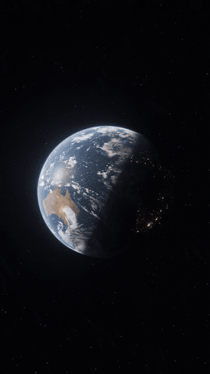
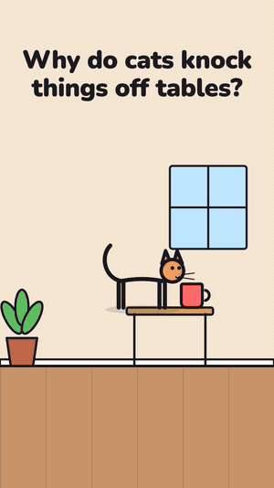
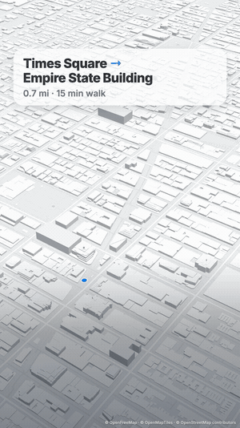

# 6 Claude skills to animate anything

Type a slash command into Claude and get a finished vertical video (1080x1920 MP4), made for real: drawn on your computer
from your numbers, real maps and real 3D, or generated with Seedance 2.5.

| Type this | You get | Preview |
|---|---|---|
| `/zachdfilms What if Earth had rings like Saturn?` | A 3D animated what-if explainer: a photoreal CGI shot with the question in big type. Needs the [Higgsfield](https://higgsfield.ai) connector with credits (about 80 per 5-second 1080p shot). |  |
| `/minimal-graphics how an idea goes viral` | Your idea explained with simple shapes, moving dots and clean animation. |  |
| `/stick-figure why do cats knock things off tables?` | A cartoon explainer acted out by stick figures, pets and props, with speech bubbles. |  |
| `/breakdown` + a product photo or name | Your product turning in 3D, pulling apart, every piece labelled. |  |
| `/map-route Times Square to Empire State` | A real 3D map with the route drawing itself between two pins. |  |
| `/graph Mar 200K, Apr 650K, Nov 1.5M` | Your numbers as a chart that builds itself on screen. |  |

## Install

### Claude Code (the Code tab of the Claude desktop app, or `claude` in a terminal)

The easy way: start a Claude Code session and paste

```
Install the six skills from https://github.com/maverickmaltin/claude-animate-skills into my ~/.claude/skills folder.
```

Or by hand: download [animate-skills-all.zip](https://github.com/maverickmaltin/claude-animate-skills/releases/latest/download/animate-skills-all.zip), unzip it, and move the six folders into `~/.claude/skills/` (create the folder if
it doesn't exist; on Windows it's `C:\Users\<you>\.claude\skills\`). Start a new session and type `/graph`,
`/map-route` ... The commands are lowercase: `/zachdfilms`, `/minimal-graphics`, `/stick-figure`, `/breakdown`,
`/map-route`, `/graph`.

The first time you render, Claude checks your computer and, if something is missing, installs Playwright (it records the
animation in a headless browser) and ffmpeg (it encodes the MP4).

### The Claude app (claude.ai)

Each skill is also its own ZIP ([zachdfilms.zip](https://github.com/maverickmaltin/claude-animate-skills/releases/latest/download/zachdfilms.zip), [minimal-graphics.zip](https://github.com/maverickmaltin/claude-animate-skills/releases/latest/download/minimal-graphics.zip), [stick-figure.zip](https://github.com/maverickmaltin/claude-animate-skills/releases/latest/download/stick-figure.zip), [breakdown.zip](https://github.com/maverickmaltin/claude-animate-skills/releases/latest/download/breakdown.zip), [map-route.zip](https://github.com/maverickmaltin/claude-animate-skills/releases/latest/download/map-route.zip), [graph.zip](https://github.com/maverickmaltin/claude-animate-skills/releases/latest/download/graph.zip)). First turn on Settings → Capabilities → **Create and edit files**
(skills need it). Then go to Customize → Skills → **+ Add** → **Upload skill**, and pick the ZIP. Skills you add there also show up
in Claude Code when you sign in with the same account.

In the app, Claude runs skills in a cloud sandbox whose network access is limited to package servers by default, and it
may not be able to run a browser there. When it can't, the animation skills hand you a page that plays the animation
instead of an MP4, `/map-route` asks you to use Claude Code, and `/zachdfilms` generates the shot (with the Higgsfield
connector added under Settings → Connectors) and gives you its link without the title. These skills were built and
tested in Claude Code: for the full MP4s, use Claude Code on your computer.

## How they work

Each folder is a standard Agent Skill: a `SKILL.md` that tells Claude what to do, `scripts/` it runs, `assets/` (the
animation page, or a font) and `examples/`. Claude turns your request into a small JSON spec (your numbers, your two
places, the parts of your product, the beats of the cartoon), checks a frame, and `scripts/render.py` opens the skill's
animation page in a headless browser, records it frame by frame and encodes the MP4. Nothing leaves your computer except
map searches and routes (OpenStreetMap community servers) for `/map-route`, and the prompt you generate on Higgsfield for
`/zachdfilms`.

You can also run them by hand:

```bash
python3 skills/graph/scripts/render.py skills/graph/examples/instagram-followers.json --out followers.mp4
python3 skills/map-route/scripts/route.py "Eiffel Tower, Paris" "Louvre, Paris" --labels "Eiffel Tower" "Louvre" --mode walk --out map.json
python3 skills/map-route/scripts/render.py map.json --out map.mp4
```

Requirements: Python 3.8+, Google Chrome (or `python3 -m playwright install chromium`), `pip install playwright`, and
ffmpeg (`brew install ffmpeg` on a Mac, or `pip install imageio-ffmpeg`). `python3 skills/graph/scripts/render.py --check`
says what's missing.

## Credits and licenses

- Code: MIT (see LICENSE).
- `/map-route`: map data © [OpenStreetMap](https://www.openstreetmap.org/copyright) contributors (ODbL), vector tiles
  by [OpenFreeMap](https://openfreemap.org) (OpenMapTiles schema), routes by [OSRM](https://project-osrm.org) on the
  [FOSSGIS](https://routing.openstreetmap.de) servers, places by Nominatim and Photon, drawn with
  [MapLibre GL JS](https://maplibre.org) (BSD-3). The attribution line stays on every video.
- `/breakdown`: [three.js](https://threejs.org) (MIT).
- Fonts: Inter and Nunito from Google Fonts, and Archivo Black (bundled with `/zachdfilms`), all under the SIL Open Font
  License.
- `/zachdfilms` generates with Seedance 2.5 through Higgsfield, on your own Higgsfield account. It is named after the 3D
  what-if explainer style it imitates and is not affiliated with any creator.
